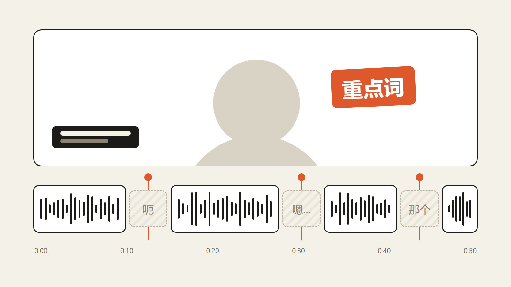

# talking-head

An [OpenFilm](https://github.com/openfilm/openfilm) skill for the plainest and most asked-for edit: a recording of
someone talking to camera, cleaned up. The ums, false starts, repeats, abandoned takes and dead air go, every cut
falls in a pause so nobody hears it, and the key words, a name card and a cover go on top.

| | | |
| --- | --- | --- |
|  | [Talking head](skills/talking-head) | Your talking recording without the ums, stumbles and dead air, cut so nobody notices, with key words, a name card and a cover. |

It is a brief and one script. Most of the work already exists in OpenFilm: `npx openfilm get asr` gives every
word's time, a recording is cut by trimming the same file, and Studio draws the subtitles of every trim from one
transcript. What the brief adds is what an agent gets wrong when nobody says it:

- only what a viewer would skip goes; their words stay in their order, and of a line said twice the last whole one
  stays;
- every cut falls in a pause of 0.12 s or more **measured in the sound**, and is checked in the frames on both sides;
- the joined sound is transcribed once more, so a cut that left a repeat in or took a word with it is caught;
- every cut longer than two seconds is reported with the words it took out, so the person can put it back;
- transcribing an hour costs an hour of the person's service, said before it starts.

The script, `skills/talking-head/scripts/cuts.mjs`, is there because a transcript is the wrong ruler for a cut. In a
trial on a 3.5-minute take (November 2026), word times ran 0.1-0.3 s off and the ums were
missing from the transcript, so cuts placed from it landed in soft speech. It measures the recording's room level and
speech level, lists the real pauses with the words around them, points at transcript gaps that hold sound, checks
every cut point in film.html, and writes the joined sound for the second transcript. It needs only ffmpeg, which
OpenFilm needs too.

For a recording where slides or screens fill the frame and the person speaks from a corner, use the official
`presenter-pip`; to make short clips from a long one, `long-to-short`.

## Use it

- **In OpenFilm**: open Skills, add one from a link, and paste `https://github.com/WEBGRS/openfilm-talking-head`.
- **In your own agent** (Claude Code, Codex and others): `npx skills add WEBGRS/openfilm-talking-head`.

It needs a transcription service connected in OpenFilm (Settings → Providers).

## Check

```sh
node scripts/check.mjs
node --test test/*.test.mjs   # needs ffmpeg
```

## 中文说明

口播剪辑用的 OpenFilm 技能：把一段对着镜头说话的录像剪干净。去掉口癖、说错重来、重复、没说完的那一遍和空档；每一刀都落在停顿里，听不出剪辑点；再加上重点词、人物名片和封面。

它是一份需求书加一个脚本。大部分能力 OpenFilm 都有：`npx openfilm get asr` 给出每个字的时间，剪辑就是对同一个文件做裁剪，Studio 按一份转写给每段裁剪出字幕。需求书补的是没人说时智能体容易做错的地方：

- 只剪观众会跳过的部分；话保持原样和原顺序，同一句说了两遍，留最后完整的那一遍；
- 每一刀都落在 0.12 秒以上的停顿里，停顿以声音实测为准，不看转写时间；再看剪点前后两帧确认；
- 剪完把拼起来的声音再转写一遍，没剪掉的重复、被误切的词都能查出来；
- 剪掉超过 2 秒的地方连同原话列出来，想要哪段可以放回去；
- 转写一小时录像就要用一小时的转写服务，开始前先说。

脚本 `cuts.mjs` 存在的原因：转写不能当剪刀的尺子。在一段 3.5 分钟录像上试剪时，词的时间偏了 0.1–0.3 秒，「um」也没转出来，照转写下刀会切进轻声的话里。脚本按录像本身的底噪和说话音量找出真实停顿并标出前后的词，指出转写空档里藏着声音的地方，检查 film.html 的每个剪点，并导出拼接后的声音供第二次转写。只需要 ffmpeg，OpenFilm 本来就要。

PPT、录屏占满画面、人在小窗里讲的，用官方的「小窗人物口播」（presenter-pip）；从长视频里剪短片，用「长视频转短视频」（long-to-short）。

**安装**：在 OpenFilm 的技能页点「添加 skill」，粘贴链接 `https://github.com/WEBGRS/openfilm-talking-head`；用自己的智能体就运行 `npx skills add WEBGRS/openfilm-talking-head`。需要先在 OpenFilm 的设置（左上角的 OpenFilm 标志）→ 服务商里连好一个语音转写服务。
